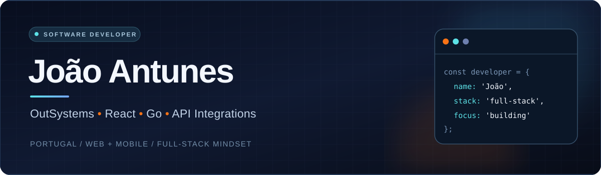

  

   

  
  

## 👋 About me

I'm **João Antunes**, a **Software Developer based in Portugal** with **4 years of experience** building web and mobile solutions, enterprise applications, and system integrations.

My professional background is grounded in **OutSystems (Reactive Web, Traditional Web and Mobile)**. I also build applications and services using **React, Go, JavaScript, SQL, REST APIs and Docker**. I enjoy taking ideas from technical design through implementation and deployment.

- 💼 **Enterprise development** — business applications, workflows, integrations and data-driven solutions.
- 🛠️ **Full-stack engineering** — frontend interfaces, backend APIs, databases and infrastructure.
- 🚀 **Product mindset** — maintainable systems, performance, security and useful user experiences.
- 🌍 **Based in Portugal** — open to collaborating on international engineering projects.

## ⚡ Technology stack

**Applications & frontend**

**Backend, databases & integrations**

**Tools & delivery**

## 🔥 Selected projects

| Project | Overview | Technologies |
| :--- | :--- | :--- |
| **[FUTRYVA](https://github.com/jmfa2310/Frutryva)** | Multi-club, multi-sport SaaS platform **under active development**, with club branding, identities and administrative workflows. | Go · React · TypeScript · PostgreSQL · Docker |
| **[NFC MABS10](https://github.com/jmfa2310/nfc_mabs10)** | Exploration and implementation work around NFC and MABS10 device integration. | NFC · Integrations |
| **[InsightFace API](https://github.com/jmfa2310/insightface-api)** | API-focused exploration of face analysis and recognition technologies. | Python · APIs · Computer Vision |
| **[Personal Portfolio](https://github.com/jmfa2310/Joao_Antunes_Portofolio)** | My personal developer portfolio and public project showcase. | Web · UI/UX |
| **[Futsal Tournament](https://github.com/jmfa2310/TorneioFutsal2026)** | Project associated with a 2026 futsal tournament. | Web development |

> Some professional and client projects are private. This profile showcases selected public work rather than client source code.

## 🎯 What I'm focused on

Building reliable applications that combine **low-code delivery, modern frontend development, backend services and integrations** — while continuing to grow in cloud infrastructure and software architecture.

---

### Let's build something useful.

**[Portfolio](https://jmfa2310.github.io/Joao_Antunes_Portofolio/)** · **[Repositories](https://github.com/jmfa2310?tab=repositories)**

Designed with care · João Antunes

